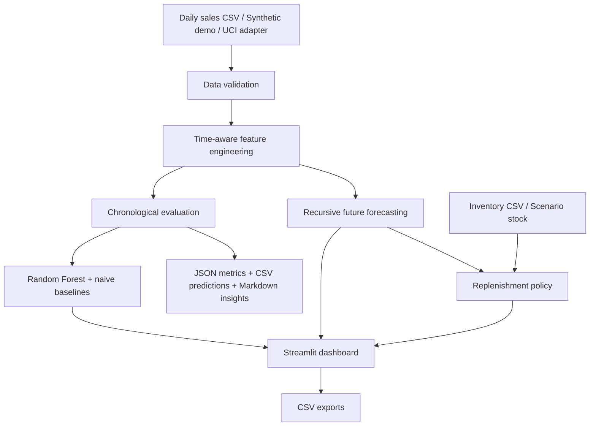

# DemandIQ — Retail Demand Forecasting & Inventory Intelligence

DemandIQ is a portfolio-grade retail analytics MVP that turns daily SKU sales into demand forecasts, model comparisons, and transparent replenishment recommendations. It includes a Streamlit dashboard, reusable Python package, reproducible benchmark workflow, public-dataset adapter, automated tests, and a Docker deployment path.

> **Project status:** Working portfolio MVP. CI is configured for Python 3.11 and 3.12. The dashboard demo uses synthetic data, and a measured UCI Online Retail benchmark is included for a documented top-100 UK product slice. The report makes no claim of production accuracy.

## What it does

- Accepts daily sales data or generates a deterministic synthetic demonstration dataset.
- Validates required fields, duplicate records, non-negative sales, and complete daily calendars.
- Builds calendar features, 1/7/14/28-day lags, and shifted seven-day rolling statistics.
- Trains a Random Forest demand model and evaluates it against last-day and seven-day seasonal-naive baselines.
- Reports MAE, RMSE, and WAPE on a chronological rolling one-step-ahead holdout.
- Compares Random Forest with last-day, seven-day seasonal-naive, and Croston SBA intermittent-demand baselines.
- Classifies each SKU from training history as smooth, erratic, intermittent, lumpy, or no-demand using ADI and CV².
- Selects an interpretable per-SKU benchmark method from training-history demand patterns and reports adaptive MAE, RMSE, and WAPE.
- Applies a transparent adaptive forecast policy per SKU: Random Forest for smooth/erratic demand, Croston SBA for intermittent/lumpy demand, and zero forecast for no-demand history.
- Generates recursive multi-day forecasts for each store/SKU.
- Produces SKU-level replenishment suggestions using lead-time demand, a days-of-demand buffer, recent demand variability, stock cover, and stockout-risk bands.
- Exports forecast and replenishment tables as CSV.
- Creates a human-readable Markdown benchmark insights report, identifying the best method per metric and comparing Random Forest WAPE with the strongest baseline.
- Runs locally with Python or inside Docker.

## Architecture



## Quick start

Python 3.11 or newer is recommended.

```bash
git clone https://github.com/Naveed05/DemandIQ.git
cd DemandIQ
python -m venv .venv
```

Activate the environment:

**Windows PowerShell**
```powershell
.\.venv\Scripts\Activate.ps1
```

**macOS / Linux**
```bash
source .venv/bin/activate
```

Install and launch:

```bash
python -m pip install --upgrade pip
pip install -e ".[dev]"
streamlit run app.py
```

The dashboard opens at `http://localhost:8501`. If no sales file is uploaded, it generates synthetic demo data automatically.

## Run tests and lint

```bash
pytest
ruff check src tests scripts app.py
```

GitHub Actions runs these checks on Python 3.11 and 3.12 for pushes and pull requests to `main`.

## Run with Docker

```bash
docker compose up --build
```

Open `http://localhost:8501`. The image uses a non-root application user and includes a Streamlit health check. GitHub Actions also starts the built container and verifies that the health endpoint responds before CI passes.

See the [container deployment guide](docs/deployment.md) for startup checks, logs, operational boundaries, and the steps needed before exposing the app beyond a trusted network.

Stop it with:

```bash
docker compose down
```

## Sales data format

Upload a CSV with exactly one observation per calendar day for each store/product series. Required columns:

| Column | Meaning |
| --- | --- |
| `date` | Calendar date |
| `store_id` | Store/location identifier |
| `product_id` | Product/SKU identifier |
| `sales` | Non-negative units sold |

Example:

```csv
date,store_id,product_id,sales
2026-01-01,STORE_01,SKU_001,12
2026-01-02,STORE_01,SKU_001,0
2026-01-03,STORE_01,SKU_001,15
```

Include explicit zero-sales rows when no sales genuinely occurred. A missing record is ambiguous and is rejected rather than silently interpreted as zero. Duplicate date/store/product records are rejected. At least 29 calendar days per series are needed for the lag features; longer histories are strongly recommended.

## Inventory data format

Optionally upload an inventory CSV to replace the fallback stock assumption for matching SKUs:

| Column | Meaning |
| --- | --- |
| `store_id` | Must match the sales data |
| `product_id` | Must match the sales data |
| `current_stock` | Non-negative on-hand units |

Example:

```csv
store_id,product_id,current_stock
STORE_01,SKU_001,120
STORE_01,SKU_002,35
```

The dashboard flags high/medium/low stockout risk and estimates order quantity to reach its reorder point. SKUs absent from the inventory file use the fallback stock input. Validate stock counts and supplier details before acting on any recommendation.

## Benchmark your own data

```bash
python scripts/benchmark.py --input path/to/daily_sales.csv --validation-days 28
```

Reports are written to `reports/benchmark/`:
- `metrics.json`: dataset summary, evaluation method, and overall MAE/RMSE/WAPE for the Random Forest and all benchmark baselines.
- `predictions.csv`: actual and predicted units for each validation row.
- `per_series_metrics.csv`: model/baseline metrics plus each SKU's training-history demand-pattern class, selected forecasting method, average demand interval (ADI), and squared coefficient of variation (CV²).
- `benchmark_summary.md`: readable interpretation with the best-performing method for each metric and a comparison against the strongest baseline.

The dashboard Method & assumptions tab also displays the full benchmark comparison, per-SKU pattern/method table, and a downloadable per-SKU report. Benchmark results are cached for unchanged sales data and validation settings. The holdout is chronological and rolling one-step-ahead: observed sales from earlier validation dates are used as lag inputs for later dates. This is distinct from the recursive future forecast shown in the dashboard. Lower MAE, RMSE, and WAPE are better. Results apply only to the selected dataset and evaluation design; do not claim the model is superior unless the measured metrics support it.

## Optional: UCI Online Retail dataset

DemandIQ includes an adapter for the [UCI Online Retail dataset](https://archive.ics.uci.edu/dataset/352/online+retail). Review the dataset's source and **CC BY 4.0** attribution requirements on its official page. Download the Excel workbook yourself; the script does not fetch data from the internet.

Install the Excel reader:

```bash
pip install -e ".[dev,data]"
```

Prepare daily sales and run the benchmark:

```bash
python scripts/prepare_uci_online_retail.py --input "path/to/Online Retail.xlsx" --country "United Kingdom" --min-history-days 60 --max-products 100
python scripts/benchmark.py --input data/processed/uci_online_retail_daily.csv --validation-days 28 --output-dir reports/uci_online_retail
```

The default output is ignored by Git. The adapter selects the 100 eligible products with the highest positive unit volume by default so the benchmark is practical on a laptop. Use `--max-products 0` to retain all eligible products; this can create more than one million daily rows and substantially increase training time. Preparation assumptions:
- The dataset has no store IDs. Country (default: United Kingdom) is used as a location proxy and must not be represented as store-level data.
- Cancellation invoices and non-positive quantities (returns/refunds) are excluded. The target is quantity sold, not revenue.
- Transactions are aggregated by date and stock code. Dates between a product's first and last eligible transaction are filled with zero; this assumes no recorded sale means zero demand and does not prove the item was in stock.
- Product series are filtered by a minimum calendar span (60 days by default). This does not guarantee dense sales or sufficient signal for reliable forecasting.

### Measured benchmark snapshot

The uploaded UCI workbook was processed for the United Kingdom and evaluated on the top 100 eligible products (35,082 daily rows; 100 product series; 2,769 validation predictions across the final 28 calendar days). Results are specific to this selected historical slice:

| Method | MAE (units) | RMSE (units) | WAPE |
| --- | ---: | ---: | ---: |
| Random Forest | 66.874 | **266.237** | 102.35% |
| Naive (last day) | 79.634 | 372.643 | 121.88% |
| Seasonal naive (7-day) | 66.499 | 362.975 | 101.78% |
| Croston SBA (alpha=0.1) | **58.921** | **264.397** | **90.18%** |

Croston SBA achieved the lowest aggregate MAE, RMSE, and WAPE in this experiment. Its WAPE was 11.40% lower than the best of the original naive baselines. It is a benchmark comparator—not the dashboard's default forecast—and its fixed alpha and results need validation on other datasets and time periods. The chronological rolling holdout uses observed earlier validation actuals for later lag features; this is not a fully recursive 28-day forecast. See [`reports/uci_online_retail/benchmark_summary.md`](reports/uci_online_retail/benchmark_summary.md) and [`metrics.json`](reports/uci_online_retail/metrics.json) for scope, full precision, and caveats.

## Repository structure

```text
DemandIQ/
├── app.py                         # Streamlit dashboard
├── src/demandiq/
│   ├── data.py                    # Data validation
│   ├── features.py                # Calendar, lag and rolling features
│   ├── forecasting.py             # Evaluation and recursive forecasts
│   ├── inventory.py               # Reorder point and risk calculations
│   ├── benchmark.py               # Benchmark metrics and insight summaries
│   ├── demand_patterns.py         # ADI/CV² demand-pattern segmentation
│   ├── model_selection.py         # Transparent demand-pattern method policy
│   └── uci_online_retail.py       # UCI workbook preparation
├── scripts/
│   ├── make_demo_data.py
│   ├── benchmark.py
│   └── prepare_uci_online_retail.py
├── tests/                          # Unit tests
├── docs/roadmap.md
├── Dockerfile
└── compose.yaml
```

## Demand pattern segmentation

The benchmark classifies each store/SKU using only dates before the validation window. Average demand interval (ADI) and the squared coefficient of variation of positive demand sizes (CV²) use conventional cutoffs of 1.32 and 0.49 to label smooth, erratic, intermittent, and lumpy series. A series with no positive training demand is labelled `no_demand`. The adaptive benchmark policy maps smooth/erratic series to Random Forest, intermittent/lumpy series to Croston SBA, and `no_demand` series to a zero forecast. Selection uses pre-validation training history—not holdout errors—so the final holdout remains an evaluation set. This is a transparent baseline policy, not a claim that these mappings are optimal for every retailer. The dashboard recursive forecast remains Random Forest in this milestone.

## Model and inventory assumptions

- Model: RandomForestRegressor with 160 trees, minimum leaf size 2, and fixed random seed.
- Intermittent-demand comparator: Croston SBA with alpha=0.1, recalculated at each validation date using only prior observations. It is not currently the dashboard's default forecast model.
- Features: calendar fields, lagged demand, and shifted rolling mean/standard deviation.
- Evaluation: chronological rolling one-step-ahead holdout; the benchmark compares Random Forest, last-day naive, seven-day seasonal naive, and Croston SBA. The dashboard continues to display the seven-day seasonal-naive baseline.
- Future forecasts: recursive multi-step predictions; prediction errors can compound across the horizon.
- Inventory: lead-time demand plus configurable safety days and a demand-variability buffer. The z multiplier is an assumption, not a calibrated service-level guarantee.
- Not yet modelled: purchase orders already in transit, supplier minimum order quantities, pack sizes, expiry, storage capacity, promotions, lost sales, stockout-censored demand, and supplier-specific lead-time uncertainty.

## Limitations and intended use

DemandIQ is an educational/portfolio decision-support MVP, not a validated production replenishment system. Validate data quality, forecast performance, stock counts, and operational constraints before making purchasing decisions. Synthetic demo metrics are only for exercising the application and are not evidence of real retailer performance.

See [the engineering roadmap](docs/roadmap.md) for what is implemented and what remains.
